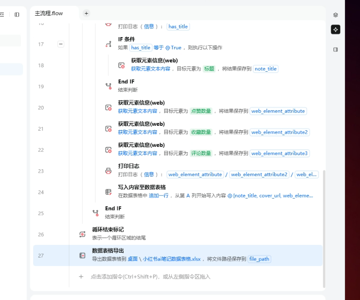
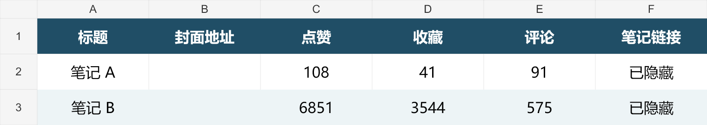

# 影刀 RPA｜小红书笔记采集与 Excel 自动导出

手动启动一次，影刀就会在 Chrome 中搜索关键词（本例为 `AI`），逐条打开笔记，读取标题和互动数据。采集循环结束后，流程自动在桌面生成一份 Excel 明细表，无需手动点击导出。**最近一次实测采集了 10 条笔记。**

**流程怎么导出？** 第 24 行把当前笔记追加到数据表格；第 26 行结束循环，第 27 行才导出 `.xlsx`。因此不需要每采一条就写一次 Excel 文件。

**实际交付什么？** 下图是 2026-11-24 导出的工作簿中，最后一批的前两条记录，按原列顺序重新排版。笔记标题已匿名，链接已隐藏；点赞、收藏、评论保留导出值。这两条的封面地址在原表中就是空值。

实测文件中保留了早期测试的表头和数据。**10 条指最后一个表头之后的本批记录，不是整个工作簿的总行数。**

## 仓库里有什么

- [主流程快照](xbot_robot/.dev/main.flow.json)：与这次导出前本机保存的同一影刀应用主流程文件一致。文件是影刀编码格式，不能作为普通 JSON 或 Python 脚本执行。
- [网页元素定位规则](xbot_robot/selectorsV2.xml)：用于定位搜索框、笔记和互动数据；公开副本移除了录制预览等辅助信息。
- [变更记录](CODEX_CHANGELOG.md)：可对照首次备份和本次自动导出版。

本仓库用于展示项目，不是影刀官方导出包；未验证在其他电脑导入运行。原始 Excel、浏览器登录状态和运行日志不随仓库发布。
